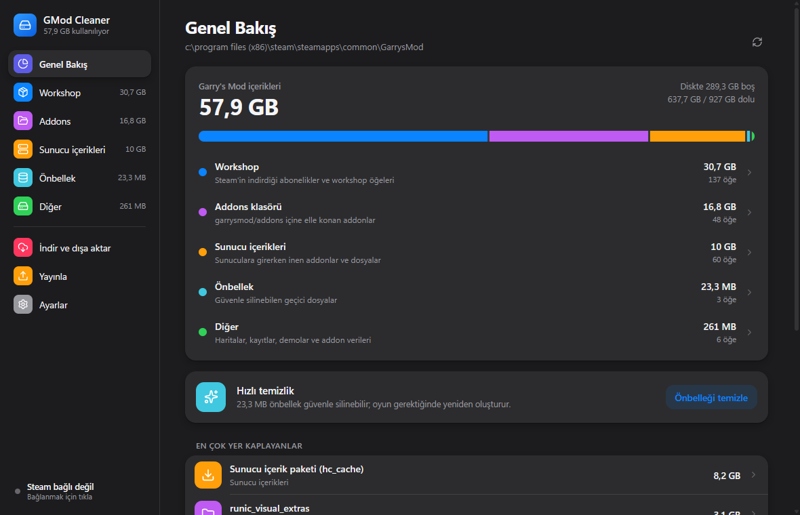
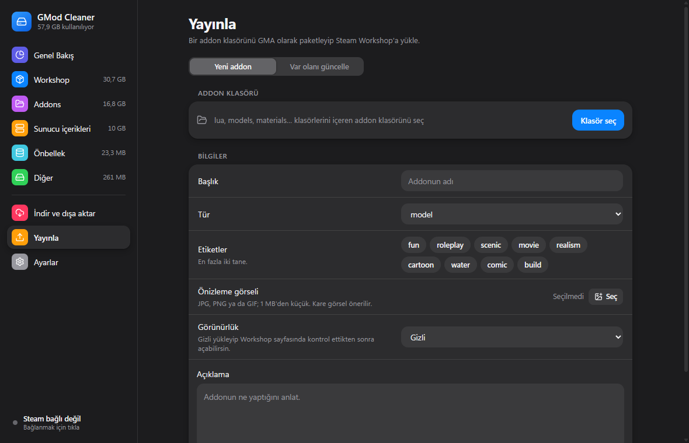

# GMod Cleaner

**English** · [Türkçe](README.tr.md)

A Windows desktop app that shows what Garry's Mod is storing on your disk and lets you clean it up. It also previews, exports and publishes `.gma` addons, in the spirit of gmpublisher.



## Download

Get the latest build from the [Releases](../../releases/latest) page:

- **`GMod-Cleaner-Setup.exe`** installs the app with a Start menu entry and an uninstaller.
- **`GMod-Cleaner-Portable.exe`** is a single file. Run it from anywhere, no installation.

Requires Windows 10 or 11 (64-bit) with the WebView2 runtime, which Windows 11 ships with.

## Features

- **Scan everything.** Workshop items, the `addons` folder, content downloaded from servers (`cache/workshop`, `download`, `hc_cache`), caches, maps and your own saves, each on its own page with search and sorting by size, name or date.
- **Preview addons.** Open any item to browse its folders, see how the size splits across `materials`, `models`, `lua` and so on, and read Lua, text and image files inside it. Works for `.gma` files and for Steam's older LZMA-compressed `_legacy.bin` files.
- **Delete without Steam bringing it back.** Delete one item with a click or select many at once. For Workshop items the app unsubscribes first, so Steam does not download them again.
- **Export.** Extract installed addons to folders or save them as `.gma`. Paste a Workshop item or collection link to download and export it in bulk without subscribing.
- **Publish.** Pack an addon folder into a GMA and upload it to the Workshop, or update one of your existing addons.



## Good to know

- Deleting moves items to the Recycle Bin by default, so space is freed once you empty it. You can switch to permanent deletion in the delete dialog or in Settings.
- Unsubscribing, downloading and publishing go through Steam. Steam must be running and the signed-in account must own Garry's Mod. While the app is connected, Steam shows you as playing Garry's Mod; you can disconnect in Settings.
- The app only deletes locations its own scan lists. Paths such as the `addons` folder itself, `cfg`, or anything outside Garry's Mod are refused.
- The interface is currently in Turkish.

## Privacy

There is no account, telemetry or API key. The app talks to Steam only: the public Steam Web API for addon titles, preview images and collection contents, and your local Steam client for subscriptions, downloads and uploads.

## Build from source

You need Node.js, Rust and the WebView2 runtime.

```bash
npm install
```

```bash
npm run tauri dev
```

```bash
npm run tauri build
```

The portable executable is written to `src-tauri/target/release/gmodcleaner.exe` and the installer to `src-tauri/target/release/bundle/nsis/`.

To try the scanner without the interface, run `cargo run --example scan` inside `src-tauri`. Run the tests with `cargo test --lib`.

## Project layout

| Path | Purpose |
| --- | --- |
| `src-tauri/src/gma.rs` | Reading, extracting and writing GMA files |
| `src-tauri/src/scan.rs` | Scanning Garry's Mod folders |
| `src-tauri/src/steam.rs` | Steamworks: unsubscribe, download, publish |
| `src-tauri/src/web.rs` | Steam Web API: item details and collections |
| `src-tauri/src/lib.rs` | Tauri commands and delete validation |
| `src/` | React and Tailwind interface |

Built with Tauri 2, Rust, React and Tailwind CSS.

## License

[MIT](LICENSE). `steam_api64.dll` is the Steamworks SDK redistributable and belongs to Valve. This project is not affiliated with Valve or Facepunch Studios.
