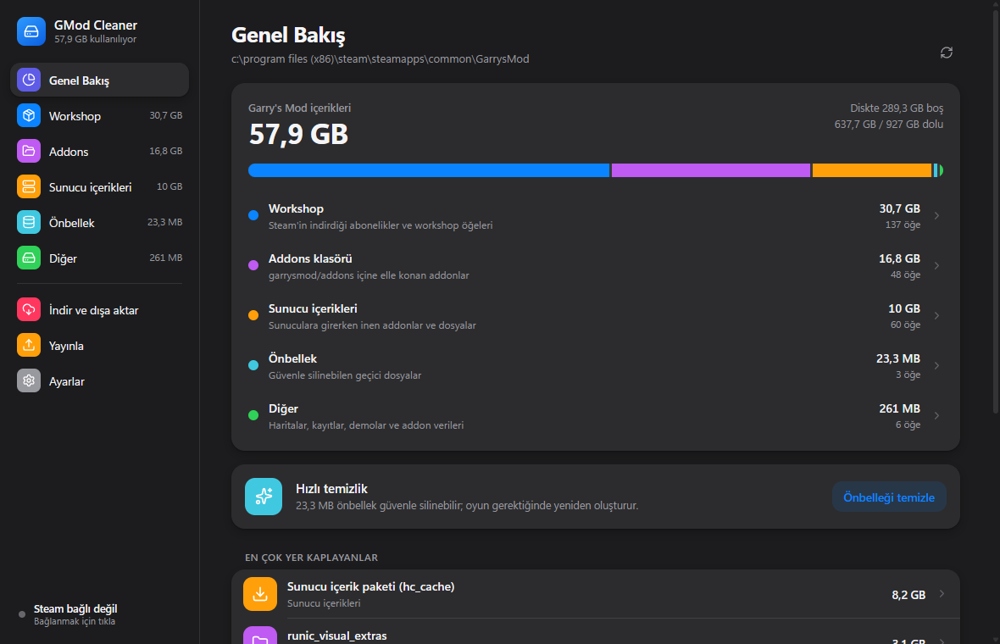
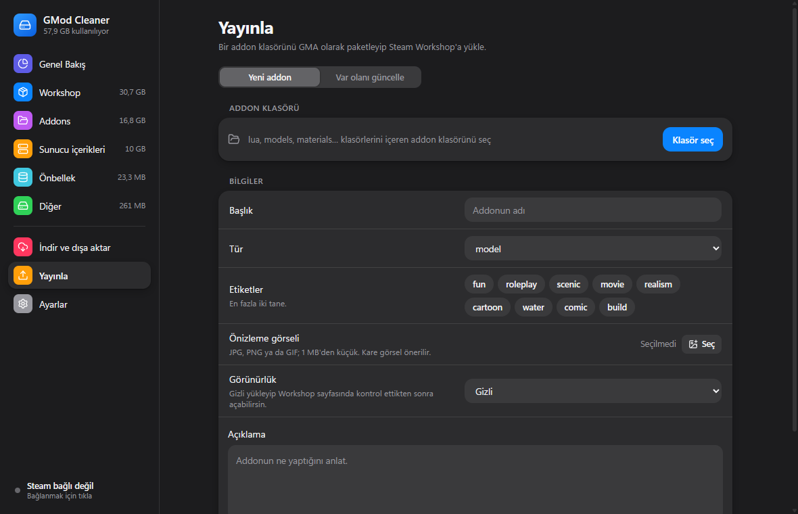

# GMod Cleaner

[English](README.md) · **Türkçe**

Garry's Mod'un diskinde neleri tuttuğunu gösteren ve temizlemeni sağlayan bir Windows uygulaması. gmpublisher gibi `.gma` addonlarını önizler, dışa aktarır ve yayınlar.



## İndir

Son sürümü [Releases](../../releases/latest) sayfasından al:

- **`GMod-Cleaner-Setup.exe`** uygulamayı Başlat menüsü kısayolu ve kaldırıcısıyla birlikte kurar.
- **`GMod-Cleaner-Portable.exe`** tek dosyadır. Kurulum gerektirmez, istediğin yerden çalıştır.

Windows 10 ya da 11 (64 bit) ve WebView2 gerekir; Windows 11'de WebView2 hazır gelir.

## Özellikler

- **Her şeyi tarar.** Workshop öğeleri, `addons` klasörü, sunuculardan inen içerikler (`cache/workshop`, `download`, `hc_cache`), önbellekler, haritalar ve kendi kayıtların ayrı sayfalarda listelenir. Arama ve boyuta, ada ya da tarihe göre sıralama vardır.
- **Addonları önizler.** Bir öğeyi açıp klasörlerinde gezebilir, boyutun `materials`, `models`, `lua` gibi klasörlere nasıl dağıldığını görebilir, içindeki Lua, metin ve görsel dosyalarını okuyabilirsin. `.gma` dosyalarında ve Steam'in eski LZMA sıkıştırmalı `_legacy.bin` dosyalarında çalışır.
- **Steam geri indirmeden siler.** Tek tıkla bir öğeyi ya da toplu seçimle birçok öğeyi silebilirsin. Workshop öğelerinde uygulama önce abonelikten çıkar, böylece Steam yeniden indirmez.
- **Dışa aktarır.** Yüklü addonları klasöre çıkarır ya da `.gma` olarak kaydeder. Bir Workshop öğesinin ya da koleksiyonunun bağlantısını yapıştırınca abone olmadan toplu indirip dışa aktarır.
- **Yayınlar.** Bir addon klasörünü GMA olarak paketleyip Workshop'a yükler ya da var olan bir addonunu günceller.



## Bilmen gerekenler

- Silme varsayılan olarak Geri Dönüşüm Kutusu'na taşır; yer, kutuyu boşaltınca açılır. Silme penceresinden ya da Ayarlar'dan kalıcı silmeye geçebilirsin.
- Abonelikten çıkma, indirme ve yayınlama Steam üzerinden yapılır. Steam açık olmalı ve oturum açılan hesapta Garry's Mod bulunmalıdır. Uygulama bağlıyken Steam seni Garry's Mod oynuyor olarak gösterir; bağlantıyı Ayarlar'dan kesebilirsin.
- Uygulama yalnızca kendi taramasının listelediği konumları siler. `addons` klasörünün kendisi, `cfg` ya da Garry's Mod dışındaki yollar reddedilir.

## Gizlilik

Hesap, telemetri ya da API anahtarı yoktur. Uygulama yalnızca Steam ile konuşur: addon başlıkları, önizleme görselleri ve koleksiyon içerikleri için herkese açık Steam Web API'si, abonelikler, indirmeler ve yüklemeler için bilgisayarındaki Steam istemcisi.

## Kaynaktan derleme

Node.js, Rust ve WebView2 gerekir.

```bash
npm install
```

```bash
npm run tauri dev
```

```bash
npm run tauri build
```

Tek dosyalık sürüm `src-tauri/target/release/gmodcleaner.exe` olarak, kurulum dosyası `src-tauri/target/release/bundle/nsis/` altına çıkar.

Taramayı arayüz olmadan denemek için `src-tauri` içinde `cargo run --example scan`, testler için `cargo test --lib` çalıştır.

## Proje yapısı

| Yol | Görevi |
| --- | --- |
| `src-tauri/src/gma.rs` | GMA okuma, çıkarma ve yazma |
| `src-tauri/src/scan.rs` | Garry's Mod klasörlerinin taranması |
| `src-tauri/src/steam.rs` | Steamworks: abonelikten çıkma, indirme, yayınlama |
| `src-tauri/src/web.rs` | Steam Web API: öğe ayrıntıları ve koleksiyonlar |
| `src-tauri/src/lib.rs` | Tauri komutları ve silme doğrulaması |
| `src/` | React ve Tailwind arayüzü |

Tauri 2, Rust, React ve Tailwind CSS ile yapıldı.

## Lisans

[MIT](LICENSE). `steam_api64.dll`, Steamworks SDK'nın yeniden dağıtılabilir dosyasıdır ve Valve'a aittir. Bu proje Valve ya da Facepunch Studios ile bağlantılı değildir.
